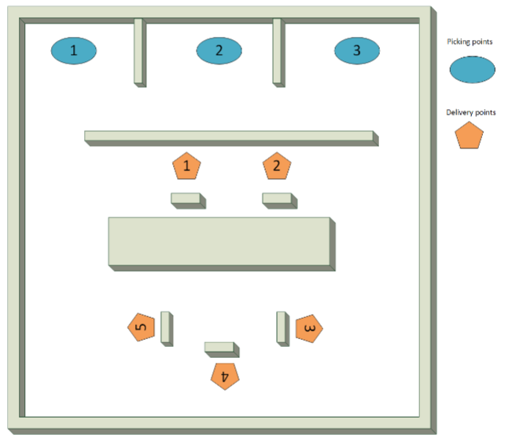
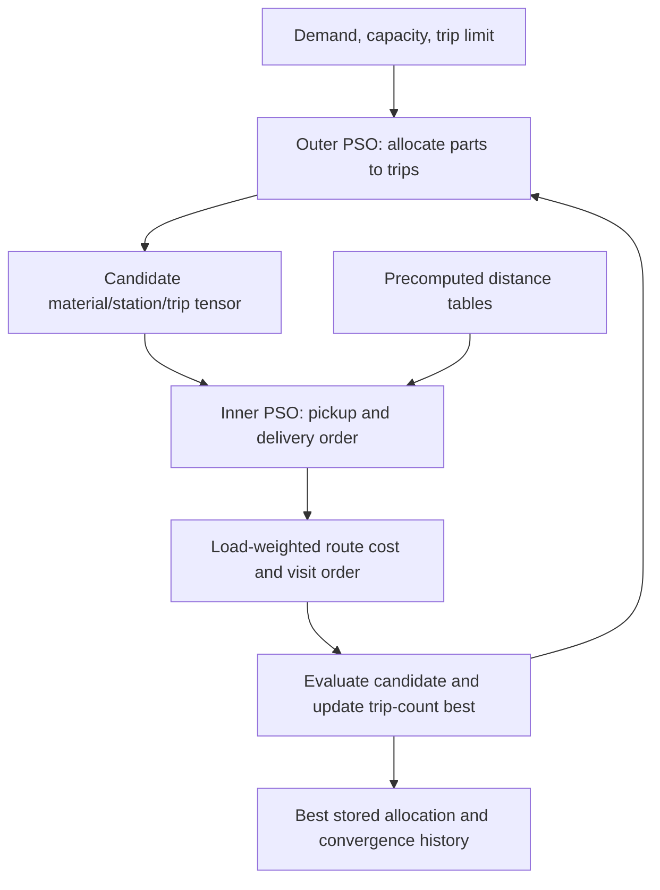
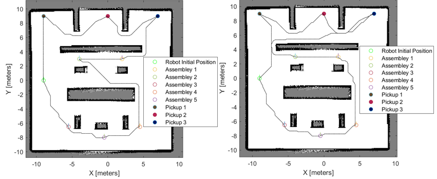
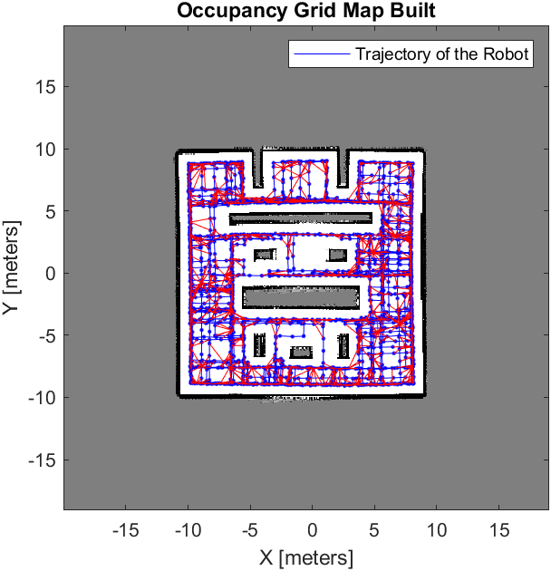

# AGV Trip Allocation and Route Planning with Nested PSO

Assembly-line material delivery with a capacity-constrained automated guided vehicle. The main MATLAB implementation uses **two particle swarm optimizers**: an outer PSO assigns parts to trips, and an inner PSO chooses pickup and delivery order for each candidate trip.

The project also includes a simple evaluation of **Particle Swarm Optimization (PSO)**, **Differential Evolution (DE)**, and **Genetic Algorithm (GA)** for route optimization, alongside occupancy-grid A* path planning and a supporting Simulink robot simulation.

**Stack:** MATLAB · Particle Swarm Optimization · A* · Occupancy Grids · Simulink

[Main optimizer](src/nested_pso/) · [Algorithm evaluation](#pso-de-and-ga-evaluation) · [Setup](docs/setup.md) · [Implementation notes](docs/implementation-notes.md)

## The delivery problem

One vehicle supplies **five assembly stations** from **three material pickup points**. Different materials have different transport-cost factors, and each trip has a finite loading capacity. The planning problem combines how much to load, which stations to supply on each trip, and the order in which locations should be visited.

[](docs/assets/assembly-environment.png)

*Project environment: three material pickup points and five assembly stations, separated by obstacles.*

| Default scenario | Value |
| --- | --- |
| Material types | Shaft A, Shaft B, screws |
| Pickup points / assembly stations | 3 / 5 |
| Total requested parts | 335 |
| Vehicle capacity | 170 parts per trip |
| Maximum trip slots | 5 |
| Allocation representation | `3 × 5 × 5` tensor: material × station × trip |
| Transport-cost factors | `[5, 4, 2]` |

```matlab
Demand_matrix = [10 18 20 50 50;
                 35  3  1  5 40;
                 15 48  7  8 25];
```

Capacity is counted in parts in this implementation; the cost factors are separate coefficients, not a physical battery or energy model.

## Two optimizers working together



### Outer PSO: trip allocation

[with_tour_optimization_diffstyle2.m](src/nested_pso/with_tour_optimization_diffstyle2.m) encodes a candidate allocation as 75 integer variables. It evaluates loading capacity, remaining demand, and trip usage, calling the inner optimizer for nonempty candidate trips.

The defaults are **100 particles and 150 iterations**, with inertia decreasing from 0.9 to 0.4. The original best-selection rule prioritizes **trip count**. Route cost and a trip penalty are calculated and stored, but do not break ties between allocations using the same number of trips.

### Inner PSO: visit order

[Seq_dis_function2.m](src/nested_pso/Seq_dis_function2.m) uses random-key encoding to search pickup and delivery permutations. It evaluates travel cost while updating the amount of each material remaining on the vehicle as materials are collected and delivered.

The inner defaults are **100 particles and 10 iterations per call**. Pickup visits precede delivery visits; the implementation does not search arbitrary interleavings of pickup and delivery.

These are heuristic searches. The code does not certify a global optimum, and the original allocation bookkeeping has edge cases documented in the [implementation notes](docs/implementation-notes.md).

## Occupancy-grid route planning

The separate [PSO routing script](src/routing/Swarm_Optimisation_8loc_pick_drop.m) combines visit ordering with A* paths on an occupancy map inflated by 0.5 m. It produces **`Final_path`**, an `N × 2` array of world-coordinate waypoints, for visualization and possible use by the simulation.

This demo has its own hardcoded material allocation. It does **not** automatically import the nested optimizer's selected trip tensor. A* supplies obstacle-aware legs between service locations; PSO chooses the service order.

[](docs/assets/route-cost-comparison.png)

*Historical project visualization: shortest-distance ordering on the left and load-weighted transport-cost ordering on the right. Carrying different materials changes which visit order is preferred.*

## PSO, DE and GA evaluation

A simple evaluation compares **Particle Swarm Optimization**, **Differential Evolution**, and **Genetic Algorithm** for pickup and delivery route ordering. The implementations record route-cost convergence across iterations or generations and visualize their resulting A* routes on the occupancy grid.

| Algorithm | Implementation | Convergence history |
| --- | --- | --- |
| Particle Swarm Optimization (PSO) | [PSO route optimizer](src/routing/Swarm_Optimisation_8loc_pick_drop.m) | `sabest_value` |
| Differential Evolution (DE) | [DE route optimizer](src/routing/Differential_evolution_8loc_.m) | `dabest_value` |
| Genetic Algorithm (GA) | [GA route optimizer](src/routing/Genetic_algorithm_8loc_pic_drop.m) | `gabest_value` |

The DE script includes a combined convergence plot of all three histories. Run PSO, then GA, then DE in the same MATLAB workspace to populate the comparison data; see the [execution guide](docs/setup.md#separate-map-based-routing-demo).

These experiments complement the main nested-PSO allocation approach. The supplied script versions use different demand, return-leg, and random-seed settings, so the default outputs are exploratory comparisons. Match those settings before reproducing a controlled quantitative benchmark.

## Project visuals

[](docs/assets/occupancy-grid.png)

*Saved occupancy grid used in the map-based routing work. Open the figure for full resolution.*

A supplementary [five-trip schedule illustration](docs/assets/five-tour-schedule.jpg) shows one historical example, rather than a newly reproduced or certified minimum. The Simulink model and virtual-world assets are retained as supporting simulation material; the project was demonstrated in simulation.

## Run the main optimizer

From the repository root in MATLAB:

```matlab
run_nested_pso
```

This entry point uses the original two PSO files and their embedded distance tables. It requires base MATLAB and does not need the saved map or Simulink model. Nested optimization can take substantial time with the original defaults.

The original script prints the stored score and trip count, displays the selected allocation tensor, and plots trip-count convergence. Its workspace variables include `tg_best` and `best_value_tour`.

For the separate occupancy-grid PSO/A* demo:

```matlab
run_route_pso
```

This loads only `map` from the supplied [MATLAB workspace snapshot](data/Full_perfect_OCC_grid_workspace.mat) and requires the relevant MATLAB navigation/robotics functionality. See the [setup guide](docs/setup.md) for versions, outputs, and the optional simulation's dependencies.

## Repository layout

```text
run_nested_pso.m                Main entry point: allocation + inner route ordering
run_route_pso.m                 Separate map-based PSO/A* route demo
src/nested_pso/                Original outer and inner PSO implementations
src/routing/                   Original PSO, GA, and DE route scripts
data/                          Saved map workspace and source manifest
simulation/                    Simulink model, X3D world, and environment builder
docs/                          Setup, implementation notes, and project figures
```

Original algorithm and simulation files are preserved. Generated Simulink caches, duplicate copies, scratch outputs, and earlier experiments are excluded. The two small entry scripts and documentation were added for this repository.

## Scope and further work

The main contribution is the combined allocation-and-ordering formulation for material delivery. Useful extensions are cost-aware tie-breaking in the outer PSO, strict per-material demand validation, filtered route endpoints, explicit transfer of selected trips into the map planner, and comparable experiments across algorithms.

The source and saved assets were inspected during repository preparation. MATLAB and Simulink were unavailable for a new execution, so no new optimization benchmark or simulation run is claimed.

Developed by **[Adhithya Palanisamy Chandrasekaran](https://github.com/ADHU-ADHU)**. MATLAB and Simulink are MathWorks products. The included simulation environment accompanies the project; the custom optimization scripts are the focus of this repository.
